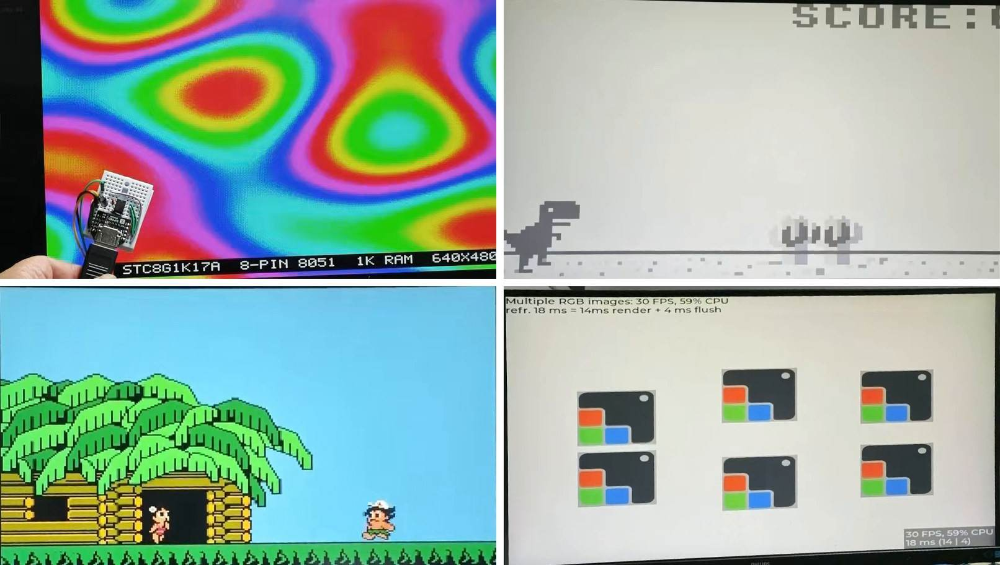
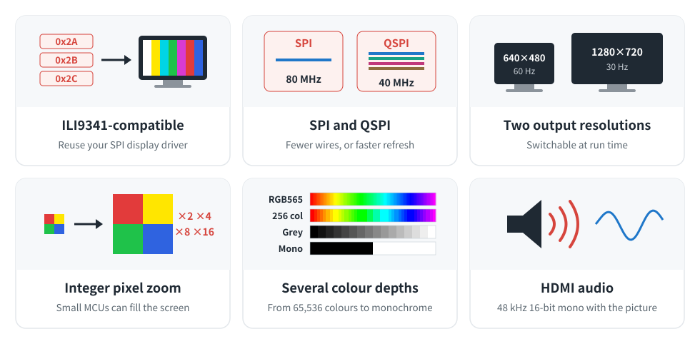
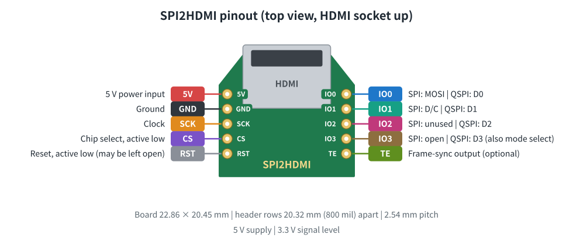
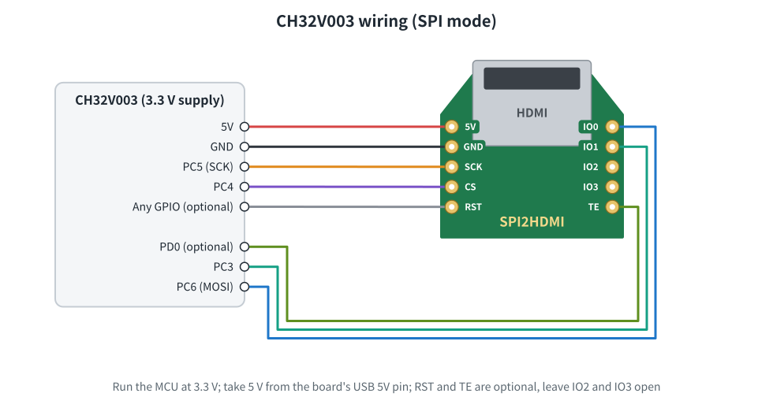
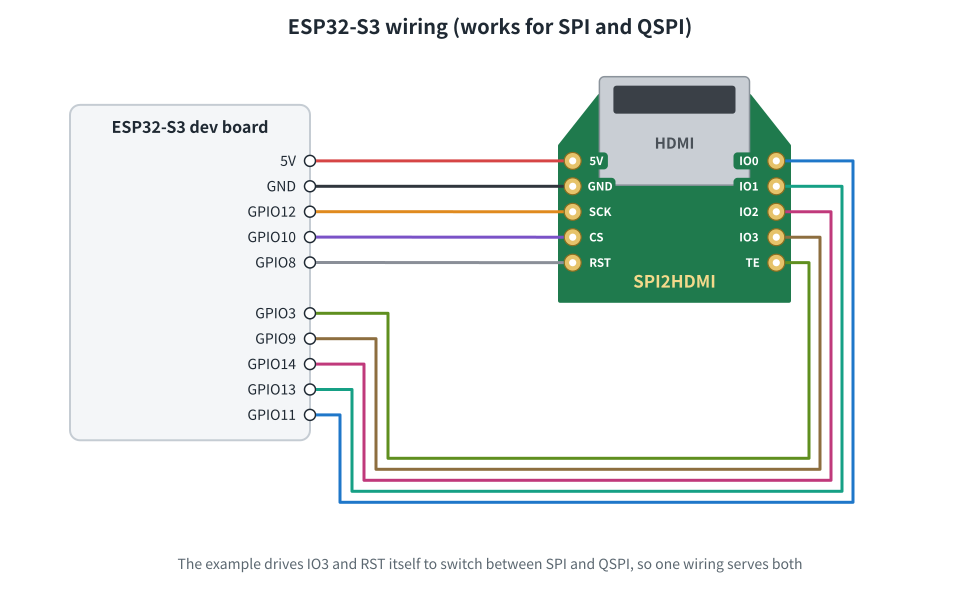

# SPI2HDMI demos

**Give any microcontroller an HDMI display.** The [Sipeed SPI2HDMI](https://wiki.sipeed.com/spi2hdmi) module is a stamp-sized board that takes the same commands as an ILI9341 SPI screen and puts the picture on an HDMI monitor or TV. If your MCU can drive an SPI display, it can drive HDMI: keep your driver, change the resolution.

This repository holds the example code. 中文说明见 [README_zh.md](README_zh.md)。



*Top left: full-screen colour animation driven by an 8-pin STC8G1K17A (8051). Top right: a dino game on a CH32V004. Bottom: an NES emulator and the LVGL benchmark on an ESP32-S3.*



## Examples

| Directory | Target | What it shows |
|---|---|---|
| [`ch32/demo`](ch32) | CH32V003 / CH32V004 | Bad Apple, Conway's Life and fractals on a 2 KB-RAM MCU |
| [`ch32/arcade`](ch32/arcade) | CH32V004 | Eight-entry menu with games, fractals and video at 720p, TE-synchronised |
| [`esp32s3/`](esp32s3) | ESP32-S3 (ESP-IDF) | `esp_lcd` panel driver for SPI and QSPI, plus an interactive console test |
| [`esp32s3/retro-go`](esp32s3#retro-go) | ESP32-S3 (ESP-IDF) | retro-go emulators (NES, Game Boy, Doom...) with HDMI picture and sound |
| [`stc8/`](stc8) | STC8G1K17A (8-pin 8051, SDCC) | Full-screen 640x480 palette animation from 1 KB of RAM; a menu, dino game and CHIP-8 console (simulation only so far) |
| [`common/spi2hdmi.h`](common/spi2hdmi.h) | any MCU | Portable single-header driver: fill in three callbacks |

```sh
git clone --recursive https://github.com/sipeed/SPI2HDMI_demo.git
```

`--recursive` also fetches the two submodules: [ch32fun](https://github.com/cnlohr/ch32fun) for the CH32 examples and the retro-go port for the ESP32-S3. Skip it and run `git submodule update --init <path>` later if you only need one of them.

## Module pins



SPI mode needs six wires: 5V, GND, SCK, CS, IO0 (MOSI) and IO1 (D/C). QSPI uses IO0–IO3 as data lines and is selected by holding IO3 high while RST is released. All signal pins use 3.3 V logic.

With no host connected the module shows eight colour bars after power-up, a quick way to check the module, cable and monitor.

## Wiring

A small MCU in SPI mode:



An ESP32-S3 with all ten wires, good for both SPI and QSPI:



## Protocol in one minute

SPI mode 0, MSB first. Commands follow the ILI9341 convention, so existing ILI9341 drivers work once the resolution is changed.

```text
0x3A 0x55                 pixel format RGB565
0x2A x0H x0L x1H x1L      column window
0x2B y0H y0L y1H y1L      row window
0x2C <pixels...>          pixel data, high byte first
```

Extensions: `0x88` pixel replication (1x to 16x), `0x8B` output mode (640x480@60 or 1280x720@30), `0x89` tint for grey formats, `0x8A` 16-colour palette, `0x8E` HDMI audio. With the single-header driver that becomes:

```c
#include "spi2hdmi.h"

spi2hdmi_t lcd;
spi2hdmi_hal_t hal = { my_spi_write, my_set_dc, my_set_cs };

s2h_init(&lcd, &hal);
s2h_set_format(&lcd, S2H_FMT_RGB565);
s2h_set_scale(&lcd, S2H_SCALE_2X);              // 320x240 canvas on a 640x480 output
s2h_fill565(&lcd, 0, 0, 319, 239, 0x001F);      // fill the screen with blue
```

The full command reference, frame-rate tables and FAQ are on the [wiki page](https://wiki.sipeed.com/spi2hdmi).

## Signal integrity

SPI runs up to 80 MHz and QSPI up to 40 MHz. Those clocks are fast for jumper wires and breadboards: if the picture jitters or shows noise, shorten the wires, keep a ground wire next to SCK, or lower the clock.

## Licenses

Each directory keeps its own license: `esp32s3/` is MIT (the retro-go submodule is GPL-2.0), `stc8/` is MIT (the CHIP-8 programs in `stc8/roms` are CC0), `ch32/arcade` is GPL-3.0-or-later because it includes third-party game code (see its `THIRD_PARTY.md`). ch32fun is a separate project under its own license.
