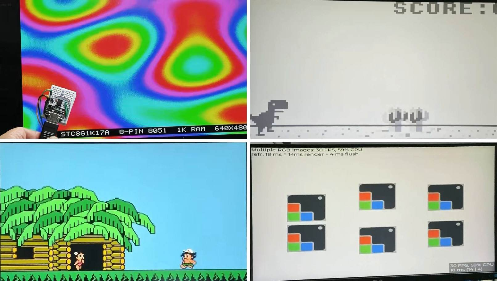
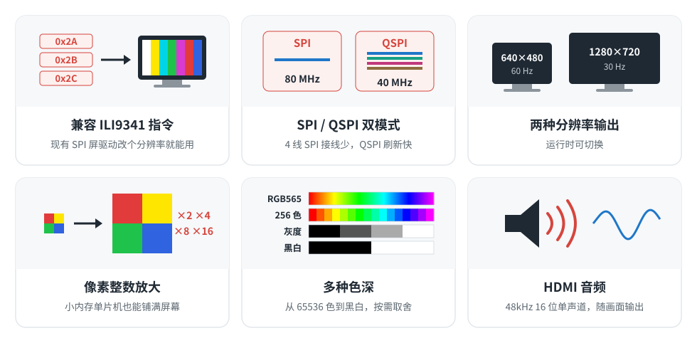
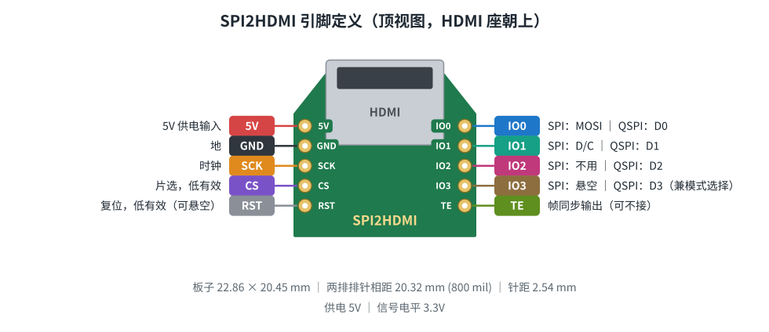
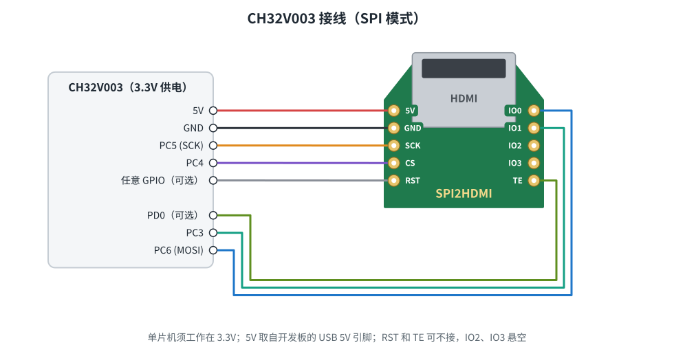
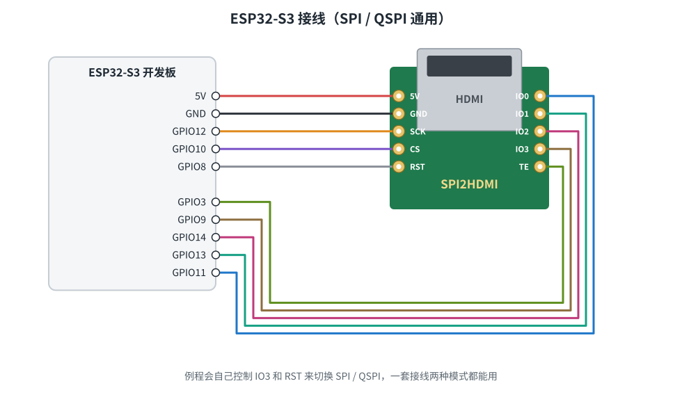

# SPI2HDMI 例程

**让任何单片机都用上 HDMI 大屏。** [Sipeed SPI2HDMI](https://wiki.sipeed.com/spi2hdmi) 是一块邮票大小的模块，指令兼容 ILI9341 SPI 屏，把画面输出到 HDMI 显示器或电视。你的单片机能驱动 SPI 屏，就能驱动 HDMI：驱动照旧，改一下分辨率即可。

这个仓库是配套的例程代码。English: [README.md](README.md)



*上排：8 脚 STC8G1K17A（51 单片机）驱动的全屏全彩动画、CH32V004 上的小恐龙游戏；下排：ESP32-S3 运行 NES 模拟器和 LVGL 基准测试。*



## 例程

| 目录 | 平台 | 内容 |
|---|---|---|
| [`ch32/demo`](ch32) | CH32V003 / CH32V004 | 在 2KB RAM 的单片机上播放 Bad Apple、生命游戏和分形 |
| [`ch32/arcade`](ch32/arcade) | CH32V004 | 八项菜单：小游戏、分形、视频，720p 输出，带 TE 同步 |
| [`esp32s3/`](esp32s3) | ESP32-S3（ESP-IDF） | 支持 SPI 和 QSPI 的 `esp_lcd` 驱动组件，以及一个串口交互测试程序 |
| [`esp32s3/retro-go`](esp32s3#retro-go) | ESP32-S3（ESP-IDF） | retro-go 模拟器合集（NES、Game Boy、Doom 等），HDMI 出画面和声音 |
| [`stc8/`](stc8) | STC8G1K17A（8 脚 8051，SDCC） | 1 KB 内存跑满屏 640x480 调色板动画；另有选单、小恐龙和 CHIP-8 游戏机（目前只在电脑上仿真过） |
| [`common/spi2hdmi.h`](common/spi2hdmi.h) | 任意单片机 | 单头文件驱动，填三个回调函数即可移植 |

```sh
git clone --recursive https://github.com/sipeed/SPI2HDMI_demo.git
```

`--recursive` 会一并拉取两个子模块：CH32 例程用的 [ch32fun](https://github.com/cnlohr/ch32fun) 和 ESP32-S3 用的 retro-go 移植。只需要其中一个时，可以先不加这个参数，之后再执行 `git submodule update --init <路径>`。

## 模块引脚



SPI 模式只需要六根线：5V、GND、SCK、CS、IO0（MOSI）、IO1（D/C）。QSPI 用 IO0~IO3 作数据线，在 RST 释放时让 IO3 保持高电平即可选中。所有信号脚都是 3.3V 电平。

不接任何主机时，模块上电会显示 8 色彩条，可以用来快速检查模块、线材和显示器。

## 接线

小单片机用 SPI 模式：



ESP32-S3 把十根线都接上，SPI 和 QSPI 都能用：



## 一分钟看懂协议

SPI 模式 0，高位在前。指令沿用 ILI9341 的习惯，现成的 ILI9341 驱动改一下分辨率就能用。

```text
0x3A 0x55                 像素格式 RGB565
0x2A x0H x0L x1H x1L      列窗口
0x2B y0H y0L y1H y1L      行窗口
0x2C <像素...>            像素数据，高字节在前
```

扩展指令：`0x88` 像素放大（1~16 倍）、`0x8B` 输出模式（640x480@60 或 1280x720@30）、`0x89` 灰度着色、`0x8A` 16 色调色板、`0x8E` HDMI 音频。用单头文件驱动写出来是这样：

```c
#include "spi2hdmi.h"

spi2hdmi_t lcd;
spi2hdmi_hal_t hal = { my_spi_write, my_set_dc, my_set_cs };

s2h_init(&lcd, &hal);
s2h_set_format(&lcd, S2H_FMT_RGB565);
s2h_set_scale(&lcd, S2H_SCALE_2X);              // 640x480 输出上的 320x240 画布
s2h_fill565(&lcd, 0, 0, 319, 239, 0x001F);      // 整屏刷成蓝色
```

完整的指令表、帧率表和常见问题见 [wiki 页面](https://wiki.sipeed.com/spi2hdmi)。

## 信号质量

SPI 最高 80MHz，QSPI 最高 40MHz。这个频率对杜邦线和面包板来说偏高：如果画面抖动或出现噪点，请缩短连线、让地线紧挨 SCK，或者降低时钟频率。

## 许可

各目录保留各自的许可：`esp32s3/` 为 MIT（其中的 retro-go 子模块为 GPL-2.0）；`stc8/` 为 MIT（`stc8/roms` 里的 CHIP-8 程序为 CC0）；`ch32/arcade` 因包含第三方游戏代码而采用 GPL-3.0-or-later（见其中的 `THIRD_PARTY.md`）。ch32fun 是独立项目，遵循其自身许可。
