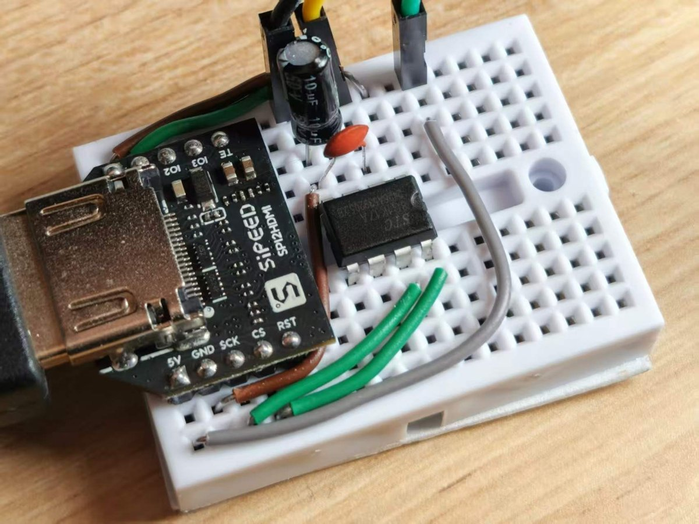
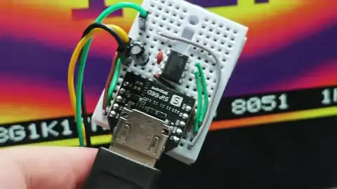

# STC8G1K17A: an 8-pin 8051 on HDMI

Two programs for the **STC8G1K17A** (8 pins, 17K flash, 1K RAM, 8051 core) on the SPI2HDMI module:

- `palette.c` -> `build/palette.hex`: full-screen 640x480, 16-colour animation. Each of three scenes is
  painted once (153,600 bytes); after that only the 16-entry palette is rewritten, 17 bytes per frame.
  5.3K flash, no external RAM.
- `main.c` -> `build/arcade.hex`: a menu, a dino game and a CHIP-8 console with 13 games (figures below).

**Status:** `palette.hex` runs on hardware (photo and clip below, 2026-11-28). `arcade.hex` builds and
passes PC simulation; it has not been run on hardware yet.





Resources used by `arcade.hex`:

| Resource | Used | Of |
|---|---|---|
| Flash | 14.8K | 17K (85%) |
| External RAM | 956 bytes | 1024 (93%) |
| Internal RAM | stack has 131 bytes free | 256 |

The MCU holds no frame buffer for the 640x480 output: the module stores the picture. The only
picture kept in RAM is CHIP-8's own 64x32 screen (256 bytes), which CHIP-8 needs for collisions.

## Wiring

See `wiring.svg` (170-point mini breadboard). The USB-serial adapter supplies 5V to the module and
3.3V to the MCU, downloads the firmware and carries the keys.

| MCU pin | To |
|---|---|
| 7 P3.2 (SCLK) | SCK |
| 1 P5.4 (MOSI) | IO0 |
| 8 P3.3 | CS |
| 3 P5.5 | IO1 (D/C) |
| 5 P3.0 (RxD) | adapter TXD |
| 6 P3.1 (TxD) | adapter RXD |

## Build and download

```sh
make                 # needs SDCC; writes build/arcade.hex
make test            # PC simulation, frames in build/frame_*.pgm
make flash PORT=/dev/ttyUSB0                      # palette demo
make flash PORT=/dev/ttyUSB0 HEX=build/arcade.hex
```

`stcgal -P stc8g -t 24000 -p /dev/ttyUSB0 build/palette.hex` trims the internal oscillator to 24 MHz and
writes the image.

The first download needs a cold start, and the adapter's TXD line gets in the way: while it idles high
it feeds the MCU through the pin's protection diode, so pulling only the 3.3V wire does not switch the
MCU off. Start the download, pull **both** the 3.3V wire and the TXD wire, wait a few seconds, then plug
both back **together**. If TXD goes back first, the MCU starts on leakage current alone: the handshake
still works, but the oscillator trim fails with `Protocol error: incorrect frame start`.

To keep TXD connected, put a diode in that line (cathode towards the adapter); then cycling the 3.3V
wire is enough.

After the first download the running firmware jumps into the download program by itself when it
receives the text `@STCISP#` at 115200 baud, so `make flash` needs no power cycling.

## Keys (serial terminal, 115200 8N1)

- Menu: `W` `S` `A` `D` move, space starts, `ESC` leaves a game.
- Dino: space jumps.
- CHIP-8 keypad: `1234 / QWER / ASDF / ZXCV`. A serial port has no key-release event, so a key
  counts as held for 1/6 s after each character.

## Files

`main.c` menu · `dino.c` · `chip8.c` · `gfx.c` text and windows · `stc8g.c` board support ·
`gen_assets.py` sprites and font (original drawings) · `roms/` CHIP-8 programs (CC0, see
`roms/SOURCES.md`) · `tests/` PC simulation.
